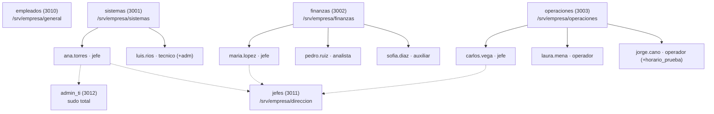

# Tarea 3.1 — Gestión automatizada de usuarios, grupos y directivas de seguridad

**Materia:** Administración de Servidores · **Unidad 3**
**Sistema probado:** Xubuntu 25.10 (VirtualBox)

Scripts en Bash para:

- Crear una estructura organizativa de grupos y carpetas por departamento.
- Dar de alta usuarios **por lotes** desde un CSV.
- Dar de baja (deshabilitar o eliminar) usuarios.
- Aplicar directivas de seguridad: privilegios sudo por rol, horarios de acceso y bloqueo por intentos fallidos.

---

## 1. Esquema organizativo



- **Grupo primario:** el departamento del usuario.
- **Grupos secundarios:**
  - `empleados`: todos los usuarios.
  - `jefes`: usuarios con rol jefe.
  - `admin_ti`: jefe de Sistemas.
  - Grupos extra indicados en el CSV.

| Grupo | GID | Propósito |
|---|---|---|
| sistemas | 3001 | Departamento de TI |
| finanzas | 3002 | Departamento de Finanzas |
| operaciones | 3003 | Departamento de Operaciones |
| empleados | 3010 | Todos los empleados (carpeta general) |
| jefes | 3011 | Jefes de área (carpeta de dirección) |
| admin_ti | 3012 | Administradores con sudo total |
| horario_prueba | 3099 | Grupo de demostración: acceso siempre denegado |

## 2. Tabla de permisos por rol

| Rol | sudo | Horario de acceso | Carpeta depto. | general | direccion | Home ajeno |
|---|---|---|---|---|---|---|
| Sistemas · jefe | **Total** (`admin_ti`) | Sin restricción | rwx | rwx | rwx | ✗ |
| Sistemas · técnico | Solo soporte: `faillock`, `systemctl restart cron`, `apt update`, `journalctl -n 50 --no-pager` | Sin restricción | rwx | rwx | ✗ | ✗ |
| Finanzas · jefe | ✗ | L-V 08:00–18:00 | rwx | rwx | rwx | ✗ |
| Finanzas · analista/auxiliar | ✗ | L-V 08:00–18:00 | rwx | rwx | ✗ | ✗ |
| Operaciones · jefe | `systemctl restart cron`, `apt update` | Diario 06:00–22:00 | rwx | rwx | rwx | ✗ |
| Operaciones · operador | `systemctl restart cron`, `apt update` | Diario 06:00–22:00 | rwx | rwx | ✗ | ✗ |
| Miembro de `horario_prueba` | — | **Nunca** | — | — | — | ✗ |

**Políticas comunes a todos los usuarios:**

- **Home privado:** `/home/<usuario>` con permisos `700`.
- **Carpetas de departamento:** permisos `2770` (setgid; los archivos nuevos heredan el grupo).
- **Contraseña temporal:** cambio obligatorio en el primer inicio de sesión (`chage -d 0`).
- **Caducidad de contraseña:** 90 días; mínimo 1 día entre cambios; aviso 7 días antes; 15 días de inactividad antes del bloqueo.
- **Expiración de la cuenta:** según la columna `expira_cuenta` del CSV.
- **Bloqueo por intentos fallidos:** 3 intentos en 15 minutos bloquean la cuenta 5 minutos (`pam_faillock`).

## 3. Estructura del repositorio

```
Unidad_3/Tarea_3.1/
├── data/usuarios.csv            # Lote de usuarios
├── scripts/
│   ├── lib/comun.sh             # Variables y funciones compartidas
│   ├── 00_ejecutar_todo.sh      # Ejecuta todo en orden
│   ├── 01_crear_grupos.sh       # Grupos + carpetas compartidas
│   ├── 02_alta_usuarios.sh      # Altas por lote desde CSV
│   ├── 03_baja_usuarios.sh      # Bajas: deshabilitar / eliminar / reactivar
│   ├── 04_politicas_sudoers.sh  # Privilegios sudo por rol
│   ├── 05_horarios_acceso.sh    # pam_time + time.conf
│   ├── 06_bloqueo_intentos.sh   # pam_faillock
│   ├── 98_revertir.sh           # Deshace todo
│   └── 99_validar.sh            # Evidencia + pruebas automáticas
└── evidencias/                  # Salida de 99_validar.sh
```

## 4. Uso

```bash
git clone https://github.com/<tu-usuario>/<tu-repo>.git
cd <tu-repo>/Unidad_3/Tarea_3.1

# Todo de una vez
sudo bash scripts/00_ejecutar_todo.sh

# O paso por paso
sudo bash scripts/01_crear_grupos.sh
sudo bash scripts/02_alta_usuarios.sh            # o: ... 02_alta_usuarios.sh otro.csv
sudo bash scripts/04_politicas_sudoers.sh
sudo bash scripts/05_horarios_acceso.sh
sudo bash scripts/06_bloqueo_intentos.sh
sudo bash scripts/99_validar.sh

# Ver contraseñas temporales generadas
sudo cat /root/tarea31_credenciales.csv

# Bajas
sudo bash scripts/03_baja_usuarios.sh sofia.diaz             # deshabilitar
sudo bash scripts/03_baja_usuarios.sh --reactivar sofia.diaz
sudo bash scripts/03_baja_usuarios.sh --eliminar jorge.cano  # respalda home y elimina

# Volver al estado inicial
sudo bash scripts/98_revertir.sh
```

Los horarios se pueden cambiar sin editar el script:

```bash
sudo HORARIO_FINANZAS="Al0000-2400" bash scripts/05_horarios_acceso.sh
```

## 5. Pruebas manuales sugeridas (video)

| Prueba | Comando | Resultado esperado |
|---|---|---|
| Cambio forzado de contraseña | `su - pedro.ruiz` | Pide una contraseña nueva |
| Aislamiento de homes | Como pedro.ruiz: `ls /home/laura.mena` | `Permiso denegado` |
| Carpeta de otro depto. | Como pedro.ruiz: `touch /srv/empresa/operaciones/x` | `Permiso denegado` |
| sudo denegado | Como pedro.ruiz: `sudo apt update` | No está en sudoers |
| sudo limitado | Como luis.rios: `sudo apt update` ✓ / `sudo cat /etc/shadow` ✗ | Solo lo permitido |
| sudo total | Como ana.torres: `sudo cat /etc/shadow` | Permitido |
| Horario | `su - jorge.cano` o login en Ctrl+Alt+F3 | Acceso denegado |
| Bloqueo | 3 contraseñas incorrectas con `su - laura.mena` | Cuenta bloqueada; `sudo faillock --user laura.mena` |
| Desbloqueo | `sudo faillock --user laura.mena --reset` | Vuelve a entrar |

## 6. Notas para Ubuntu 25.10

- El `sudo` por defecto es **sudo-rs**. Las reglas usan sintaxis compatible con sudo-rs y con el sudo clásico, y se validan con `visudo` antes de instalarse.
- La política de bloqueo **también aplica al administrador**. Mientras pruebas, deja abierta una terminal con `sudo -i`.
- Si LightDM tiene inicio de sesión automático, `00_ejecutar_todo.sh` lo avisa.
- Si los scripts dan error `$'\r': command not found`, conviértelos a fin de línea Unix con `sed -i 's/\r$//' scripts/*.sh scripts/lib/*.sh`.
