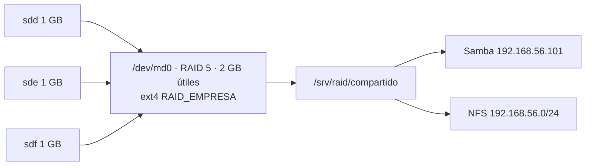

# Tarea 3.3 — Almacenamiento redundante (RAID/NAS) y colas de impresión

**Materia:** Administración de Servidores · **Unidad 3**
**Sistema:** Xubuntu 25.10 en VirtualBox · IP de la red interna: `192.168.56.101`
**Requisito previo:** la [Tarea 3.1](../Tarea_3.1) aplicada, porque aquí se usan sus usuarios y grupos.

## Contenido

```
Tarea_3.3/
├── scripts/
│   ├── lib/comun.sh                # Variables y funciones compartidas
│   ├── 00_crear_raid.sh            # RAID 5 con mdadm + ext4 + fstab + mdadm.conf
│   ├── montar_raid.sh              # Ensambla y monta el RAID (script de montaje)
│   ├── 01_simular_fallo.sh         # Falla, degradación y reconstrucción con logs
│   ├── 02_compartir_samba_nfs.sh   # Samba (Windows) y NFS (Linux)
│   ├── 03_impresion_cups.sh        # CUPS: drivers, colas, prioridades, cuotas, red
│   ├── 04_prueba_impresion.sh      # Demuestra prioridades y permisos de impresión
│   ├── 98_revertir.sh              # Deshace todo (borra el RAID)
│   └── 99_validar.sh               # Evidencia + pruebas automáticas
├── config/
│   ├── smb.conf                    # -> /etc/samba/smb.conf
│   └── exports                     # -> /etc/exports
├── logs/                           # raid_creacion_*, degradacion_*, reconstruccion_*
├── docs/guion_video.md
└── evidencias/
```

## Diseño

### RAID 5



| Elemento | Valor |
|---|---|
| Nivel | RAID 5: datos + paridad distribuida; tolera la falla de **1 disco** |
| Discos | `sdd`, `sde`, `sdf` (1 GB c/u) |
| Capacidad útil | (3 − 1) × 1 GB = **2 GB** |
| Arreglo / punto de montaje | `/dev/md0` → `/srv/raid` |
| Persistencia | `/etc/mdadm/mdadm.conf` + initramfs + `/etc/fstab` (UUID, `nofail`) |

### Recursos compartidos

| Recurso | Ruta | Samba (`valid users`) | NFS |
|---|---|---|---|
| general | /srv/raid/compartido/general | `@empleados` | rw para 192.168.56.0/24 |
| sistemas | /srv/raid/compartido/sistemas | `@sistemas` | — |
| finanzas | /srv/raid/compartido/finanzas | `@finanzas` | — |
| operaciones | /srv/raid/compartido/operaciones | `@operaciones` | ro para 192.168.56.0/24 |

**Seguridad de Samba:**

- Sin invitados ni acceso anónimo.
- Protocolo SMB2 o superior.
- Solo escucha en `localhost` y en la red interna `192.168.56.0/24`.

**NFS:** usa `root_squash`, así que el root de un cliente no es root en el servidor.

### Impresión (CUPS + cups-pdf)

| Cola | Pueden imprimir | Prioridad por defecto | Cuota |
|---|---|---|---|
| PDF_General | Todos (también desde la red) | 50 | — |
| PDF_Finanzas | `@finanzas`, `@jefes`, `@admin_ti` | 50 | 100 páginas/día |
| PDF_Direccion | `@jefes` | **90** (alta) | — |
| Clase **Oficina** | PDF_General + PDF_Finanzas | — | — |

- **Controlador:** PPD de cups-pdf (`lpinfo -m | grep -i cups-pdf`).
- **Dispositivo:** `cups-pdf:/`.
- **Red:** IPP por TCP/IP en el puerto **631** (`cupsctl --share-printers --remote-admin`).

## Uso

```bash
cd Unidad_3/Tarea_3.3
sudo bash scripts/00_crear_raid.sh                 # pide escribir RAID
sudo bash scripts/02_compartir_samba_nfs.sh        # o: --password Demo2026#
sudo bash scripts/03_impresion_cups.sh
sudo bash scripts/04_prueba_impresion.sh
sudo bash scripts/01_simular_fallo.sh --fallo      # degrada el arreglo
sudo bash scripts/01_simular_fallo.sh --reconstruir
sudo bash scripts/99_validar.sh
```

## Pruebas desde Windows

**Carpetas (Samba).** En el Explorador de archivos escribe `\\192.168.56.101\finanzas` y entra con un usuario de Finanzas. Su contraseña de Samba está en `sudo cat /root/tarea33_samba.csv`.

> Windows guarda la sesión. Para entrar con otro usuario, en `cmd` ejecuta `net use * /delete` y vuelve a abrir la ruta.

**Impresora (IPP).**

1. Ve a *Configuración → Bluetooth y dispositivos → Impresoras → Agregar dispositivo → Agregar manualmente*.
2. Elige **"Seleccionar una impresora compartida por nombre"** y escribe `http://192.168.56.101:631/printers/PDF_General`.
3. Controlador: **Microsoft → Microsoft PS Class Driver**.
4. Imprime una página de prueba. El PDF aparece en la VM en `/var/spool/cups-pdf/ANONYMOUS/`.

**Administración web.** Abre `http://192.168.56.101:631` desde el navegador de Windows.

## Comandos útiles

```bash
cat /proc/mdstat
sudo mdadm --detail /dev/md0
sudo mdadm --manage /dev/md0 --fail /dev/sde      # simular falla manual
testparm -s
sudo exportfs -v
lpstat -t
lpq -P PDF_General
lpinfo -m | grep -i pdf
```
